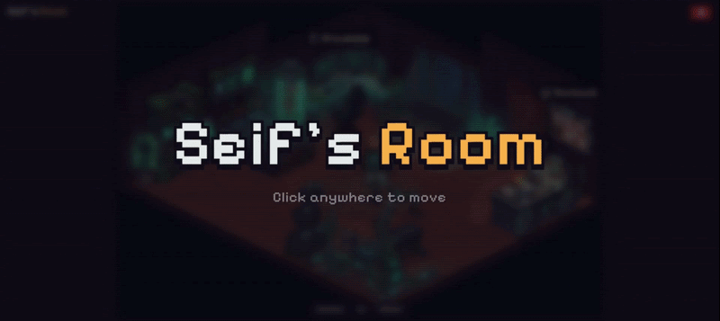

# Portfolio Room

**An interactive pixel-art portfolio: walk a capybara around an isometric room to open my projects, CV and contacts.**

Portfolio Room is the personal portfolio website of Seif Jlassi, computer science student at TU Dortmund. It is a
point-and-click game instead of a scrolling page: click the tech lab, the bureau or the corkboard to open Projects, CV
or Contact. Plain HTML, CSS and JavaScript, no build step, hosted on GitHub Pages, in English, German and French.

## Try it

Visit **https://seifpetit.github.io/Portfolio-room/** with a mouse or touch screen; the buttons under the room jump
to each zone, and <kbd>D</kbd> makes the capybara drink. To run a clone locally, start `python -m http.server 8000`
in its folder and open http://localhost:8000 (double-clicking `index.html` only shows placeholder text).

## How it works

- [Content contract](CONTENT-CONTRACT.md): every text, link and image lives in `content.json`; the page only shows it.
- [Room zones](room/zones/README.md): each clickable spot is one file in `room/zones/`, switched on by one line.

## Known issues

- The Tunisian (Tounsi) language option still falls back to English almost everywhere.
